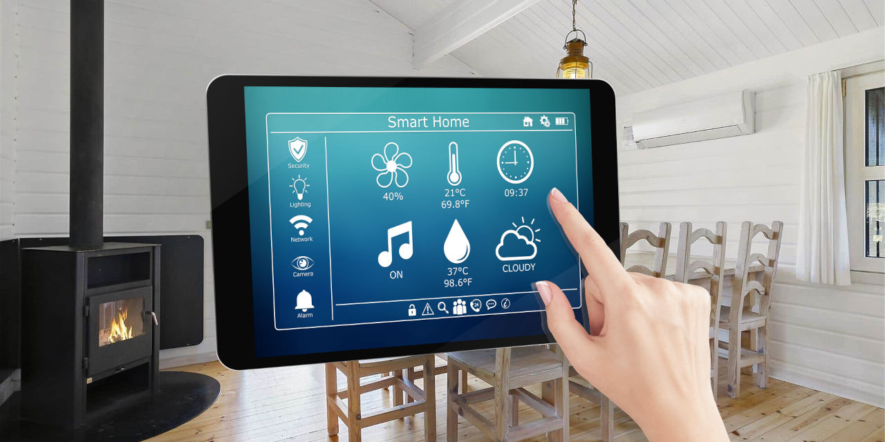

# PIIR

[](https://github.com/mortenmathiasen/piir/actions/workflows/ci.yml)

PIIR is a command line tool to transmit IR-signals like remote controls do. PIIR is created as a generic tool that supports configuration and transmission of any signal, eg. including long aircondition signals.



Examples:
```
piir --remote sony/RM-ED011 --feature key=KEY_POWER

piir --remote hvac_panasonic --feature temperature=21 --feature mode=HEAT
```

## Table of contents

  * [Features](#features)
    + [IR-protocol](#ir-protocol)
    + [Supported systems](#supported-systems)
    + [Supported hardware](#supported-hardware)
    + [Prerequisites](#prerequisites)
  * [Getting Started](#getting-started)
    + [Prebuilt packages](#prebuilt-packages)
    + [Compilation](#compilation)
    + [Installation](#installation)
    + [Deployment](#deployment)
      - [Cross compiling for Raspberry Pi](#cross-compiling-for-raspberry-pi)
    + [Testing](#testing)
    + [Releases](#releases)
    + [Upgrading from PIIR 1.x](#upgrading-from-piir-1x)
  * [How to use](#how-to-use)
  * [Remotes](#remotes)
    + [Choosing the remotes of an installation](#choosing-the-remotes-of-an-installation)
    + [Remotes converted from LIRC](#remotes-converted-from-lirc)
    + [Toggle bits](#toggle-bits)
  * [Contributing](#contributing)
  * [Versioning](#versioning)
  * [Authors](#authors)
  * [License](#license)
  * [Acknowledgments](#acknowledgments)

## Features

- Send infrared commands to control aircondition etc.
- Transmit any IR signal using any protocol.
- Integration to home automation and other systems.
- Customization by configuration and plugins.

### IR-protocol

To control an IR-receiver you need to know the IR-signals to transmit to it. Either, you can:
* Use the protocol definitions that exists already inside PIIRs remote folder [conf/remotes](https://github.com/mortenmathiasen/piir/tree/master/conf/remotes): more than 3000 remotes from over 500 manufacturers, most of them converted from the [LIRC remote database](https://sourceforge.net/p/lirc-remotes/code/ci/master/tree/remotes), see [Remotes](#remotes)
* Convert a LIRC configuration (`lircd.conf`) you already have with [tools/lirc2piir.py](tools/lirc2piir.py)
* Reverse engineer your remote control, e.g. using [IR decoder for Arduino](https://github.com/ToniA/Raw-IR-decoder-for-Arduino.git) which I did for [Panasonic airconditioner](https://github.com/mortenmathiasen/piir/blob/master/conf/remotes/panasonic/hvac_panasonic.pdf)

### Supported systems

The tool is developed in C to support deployment on any platform. 

### Supported hardware

The tool supports IR transmission by:
* Raspberry Pi (all models, including Pi 5) using the Linux kernel IR transmitter driver, [libgpiod](https://git.kernel.org/pub/scm/libs/libgpiod/libgpiod.git/) or [PIGPIO](http://abyz.me.uk/rpi/pigpio/)
* more platforms to come

### Prerequisites

To be able to transmit IR signal you need an IR led, either:
* build the electronics yourself, e.g. as mentioned at [Raspberry-PI-Geek](https://www.raspberry-pi-geek.com/Archive/2015/10/Raspberry-Pi-IR-remote)
* apply an premade pHAT, eg. [ANAVI Infrared pHAT](https://anavi.technology/)

## Getting Started

You need to identify a device you want to control by IR-signals, e.g. an airconditioner, a TV or similar.

### Prebuilt packages

Every [release](https://github.com/mortenmathiasen/piir/releases) has ready-made packages using the kernel driver (`lirc`) backend. The binaries are statically linked, so they run on any Raspberry Pi OS release:

| Package | Raspberry Pi models | OS |
|---------|---------------------|----|
| `armv6` | Pi 1, Zero, Zero W and every other Pi | 32-bit |
| `armv7` | Pi 2, 3, 4, 400, Zero 2 W | 32-bit |
| `aarch64` | Pi 3, 4, 400, 5, 500, Zero 2 W | 64-bit |

If you are unsure, run `dpkg --print-architecture` on the Pi: `arm64` needs the `aarch64` package, and `armhf` needs `armv6` or `armv7` (`armv6` works on every model).

The packages contain PIIR's own remotes. Add the remotes you need from the LIRC database afterwards with `piir-remotes`, see [Choosing the remotes of an installation](#choosing-the-remotes-of-an-installation).

Install the Debian package, e.g. for a Pi Zero W:
```
sudo apt install ./piir_2.2.0_armv6.deb
```
or extract the tarball into `/`:
```
sudo tar -xzf piir-2.2.0-armv6.tar.gz -C / --strip-components=1
```

Then enable the kernel IR transmitter as described below.

### Compilation

Update package list:
```
sudo apt update
```

By default PIIR sends IR through the Linux kernel's IR transmitter driver, which generates the carrier with accurate timing on every Raspberry Pi model including Pi 5. No extra library is needed. Enable the driver by adding this line to `/boot/firmware/config.txt` and rebooting:
```
dtoverlay=gpio-ir-tx,gpio_pin=17
```
Use the GPIO pin your IR LED is connected to. This creates `/dev/lirc0`. If that is not your transmitter device (for example because an IR receiver overlay is also enabled), set `"device": "/dev/lirc1"` in the `transmitter` section of the remote's JSON file. The user running PIIR must be allowed to write to the device: check its group with `ls -l /dev/lirc0` and add your user to that group, or run PIIR with `sudo`.

Alternatively PIIR can drive the pin itself through [libgpiod](https://git.kernel.org/pub/scm/libs/libgpiod/libgpiod.git/) version 2.0 or newer (`sudo apt install -y libgpiod-dev`) or [PIGPIO](http://abyz.me.uk/rpi/pigpio/) (`sudo apt install -y pigpio`, not supported on Pi 5). With libgpiod the carrier is generated from user space, so its timing is much less accurate. With these backends the pin is taken from `outpin` in the remote's JSON file.

Install CMake to enable compilation
```
sudo apt-get install -y cmake build-essential
```

Download and extract latest released PIIR software:
```
curl -s https://api.github.com/repos/mortenmathiasen/piir/releases/latest | sed -n 's/.*tarball_url":\s"\(.*\)".*/\1 -O piir.tar/p' | xargs wget
mkdir piir
tar xf piir.tar -C ./piir
mv ./piir/*/* ./piir
```

Now compile it:
```
cd piir
cmake -B build
cmake --build build
```

PIIR uses the kernel driver (`lirc`) when the kernel headers provide `linux/lirc.h`, which they do on any Linux system, and otherwise falls back to libgpiod and then pigpio. To pick one explicitly, add `-DPIIR_GPIO_BACKEND=lirc`, `gpiod` or `pigpio` to the first `cmake` command.

### Installation

After compilation you can install the PIIR tool by:
```
sudo cmake --install build
```

### Deployment

You can deploy the PIIR tool to any live system. Either you can compile the sourced code directly on the live system as explained above or you can compile it on another development system and then move the  execution file to your live system.

#### Cross compiling for Raspberry Pi

Toolchain files for 64-bit (`aarch64`) and 32-bit (`armhf`) Raspberry Pi OS are in `cmake/`. On a Debian/Ubuntu build machine, install the cross compiler, for example for 64-bit:
```
sudo apt install -y gcc-aarch64-linux-gnu
```

The default `lirc` backend needs nothing beyond the cross compiler. Only for the `gpiod` or `pigpio` backend must PIIR link against the library built for the Pi. Either install the Debian multiarch package:
```
sudo dpkg --add-architecture arm64
sudo apt update
sudo apt install -y libgpiod-dev:arm64
```
or copy a sysroot from the Pi (requires `libgpiod-dev` or `pigpio` installed on the Pi):
```
mkdir -p rpi-sysroot/usr
rsync -a pi@raspberrypi:/usr/include pi@raspberrypi:/usr/lib rpi-sysroot/usr/
rsync -a pi@raspberrypi:/lib rpi-sysroot/
```

Then configure and build:
```
cmake -B build-rpi -DCMAKE_TOOLCHAIN_FILE=cmake/toolchain-rpi-aarch64.cmake
# or, with a sysroot:
cmake -B build-rpi -DCMAKE_TOOLCHAIN_FILE=cmake/toolchain-rpi-aarch64.cmake -DRPI_SYSROOT=$PWD/rpi-sysroot
cmake --build build-rpi
```

Copy `build-rpi/piir` to the Pi and the remotes you need from `conf/remotes/` to `/usr/local/share/piir/conf/remotes/` (or whatever `CMAKE_INSTALL_PREFIX` you configured with). For 32-bit Raspberry Pi OS use `cmake/toolchain-rpi-armhf.cmake`, `gcc-arm-linux-gnueabihf` and `libgpiod-dev:armhf` instead. That toolchain targets ARMv7, so it does not support the Pi 1 or Pi Zero/Zero W.

For the Pi 1 and Pi Zero/Zero W (ARMv6) use `cmake/toolchain-rpi-armv6.cmake` with `gcc-arm-linux-gnueabi`. It builds a static binary with the `lirc` backend that runs on every 32-bit Pi. For the `gpiod` or `pigpio` backend on ARMv6, compile on the Pi itself.

Add `-DPIIR_STATIC=ON` to link statically, so the binary does not depend on the C library version of the Pi's OS. `cpack` in the build directory creates `.tar.gz` and `.deb` packages; configure with `-DCMAKE_INSTALL_PREFIX=/usr` first so the packaged binary finds its remotes in `/usr/share/piir`.

### Testing

The unit and command line tests run with CTest:
```
cmake -B build
cmake --build build
ctest --test-dir build --output-on-failure
```

They cover the configuration loader, remote lookup, the remote plugins, the transmitter backend selected at configure time, the `piir` command line, `piir-remotes` and the LIRC converter. Every key of every remote in `conf/remotes/` is checked to produce a code PIIR can send. The `tests` section of a remote lists features and the code a real remote sends for them, and every one of these vectors is checked. Vectors that do not match yet are listed in `tests/known_failures.txt`. No test transmits IR, so they are safe to run on a Pi.

To measure coverage, configure with `-DPIIR_COVERAGE=ON` and run [gcovr](https://gcovr.com) after the tests; the converter is measured too when Python's `coverage` module is installed:
```
cmake -B build-coverage -DPIIR_COVERAGE=ON
cmake --build build-coverage
ctest --test-dir build-coverage
gcovr -r . build-coverage --exclude 'src/parson\..*' --exclude 'tests/'
```
The transmitter backends are tested against simulated drivers and libraries (the `ioctl` and `write` calls of the `lirc` backend, libgpiod and pigpio are replaced when linking the tests), so the tests cover sending without hardware. CI requires 95% line coverage of the C code and of the converter.

When cross compiling, tests run under qemu if you add for example `-DCMAKE_CROSSCOMPILING_EMULATOR=$(command -v qemu-aarch64)` (from the `qemu-user` package).

GitHub Actions runs the tests for all three backends, with AddressSanitizer and UndefinedBehaviorSanitizer, measures coverage, and runs the tests of the `armv6`, `armv7` and `aarch64` builds under qemu.

### Releases

To release, update `VERSION` in `CMakeLists.txt`, commit, and push a matching tag:
```
git tag v2.3.0
git push origin v2.3.0
```
GitHub Actions then runs all tests, builds the packages for every Raspberry Pi architecture and the archive of all remotes (`piir-remotes-<version>.tar.gz`), and publishes them with checksums as a GitHub release.

### Upgrading from PIIR 1.x

The command line options and remote files of PIIR 1.x still work. These things changed:

* **Build system.** PIIR is built with CMake instead of autotools: `./autogen.sh && ./configure && make && sudo make install` becomes `cmake -B build && cmake --build build && sudo cmake --install build`. The default installation prefix is still `/usr/local`.
* **Transmitter.** PIIR 1.x always used pigpio. PIIR 2 prefers the Linux kernel IR driver, which works on every Raspberry Pi including Pi 5, but needs `dtoverlay=gpio-ir-tx,gpio_pin=17` in `/boot/firmware/config.txt` (see [Compilation](#compilation)). The overlay sets the GPIO pin, so `outpin` in a remote file is not used by this backend. Without the overlay PIIR stops with `Cannot open /dev/lirc0`. To keep using pigpio and `outpin`, build with `-DPIIR_GPIO_BACKEND=pigpio` (this does not compile in release 2.0.0; use 2.1.0 or later).
* **Exit codes and output.** On errors and after `--help`, PIIR 1.x aborted (exit code 134); PIIR 2 exits with 1. The `gpioWaveTxSend OK` line is only printed by the pigpio backend.
* **Remote locations.** The remotes shipped with PIIR are in manufacturer directories, e.g. `conf/remotes/panasonic/hvac_panasonic.json`. Your own remotes directly in `conf/remotes/` are still found, and `--remote hvac_panasonic` still works. Release packages contain only PIIR's own remotes; add others with [piir-remotes](#choosing-the-remotes-of-an-installation).
* **Plugins.** A remote now names its plugin, e.g. `"plugin": "hvac_panasonic"`. Remote files without this setting whose path contains `hvac_panasonic` still get the Panasonic checksum, as in PIIR 1.x.
* **Codes sent.** PIIR 1.x only applied the last `--feature` given; PIIR 2 applies all of them, in the order of the remote file (see [How to use](#how-to-use)). For `hvac_panasonic`, `mode=FAN` now sends the fixed 27 degrees and `option=QUIET`, `option=8` and `option=10` override the fan speed and mode, as the original remote does. The same command can therefore send a different, correct code than PIIR 1.x.

## How to use

You kan get command line help running:
```
piir --help
```

Output will be like:
```
3112 remotes available in /home/pi/piir/conf/remotes/ and /usr/local/share/piir/conf/remotes/, list them with: piir --list

usage:      piir
            --remote, -r REMOTE
            [--feature, -f NAME=VALUE]
            [--verbose, -v (TRACE|DEBUG|INFO|WARN|ERROR|FATAL|NOTHING)]
            [--list, -l]
            [--help, -h]

REMOTE is a remote name from --list, e.g. sony/RM-ED011, a file name
that is unique among the remotes, e.g. RM-ED011, or a path to a JSON file.

examples:   piir --help
            piir --list
            piir --remote hvac_panasonic --help
            piir --remote hvac_panasonic --feature temperature=21
            piir --remote sony/RM-ED011 --feature key=KEY_POWER
```

PIIR looks for remotes in `conf/remotes/` below the current directory and then in its installation directory (`/usr/local/share/piir/conf/remotes/` or `/usr/share/piir/conf/remotes/` for the packages). Remotes are named `<manufacturer>/<model>`, like the files in those directories. List them with:
```
piir --list | grep -i sony
```

Specific help on available features for a particular remote can be achieved by:
```
piir --remote hvac_panasonic --help
```

Output will be like:
```
Features in config file /home/pi/piir/conf/remotes/panasonic/hvac_panasonic.json:
       temperature:
              8
              10
              16
              17
              18
              19
              20
              21
              22
              23
              24
              25
              26
              27
              28
              29
              30
       mode:
              AUTO
              HEAT
              COOL
              FAN
              OFF
       option:
              AUTO
              QUIET
              POWERFUL
       fan:
              AUTO
              VERYSLOW
              SLOW
              MEDIUM
              FAST
              VERYFAST
       updown:
              AUTO
              VERYLOW
              LOW
              MIDDLE
              HIGH
              VERYHIGH
       leftright:
              AUTO
              VERYLEFT
              LEFT
              MIDDLE
              RIGHT
              VERYRIGHT

usage:      piir
            ...
```

A working example combining more features into the IR signal:
```
sudo piir --remote hvac_panasonic --feature temperature=21 --feature mode=HEAT --feature option=AUTO --feature fan=AUTO --feature updown=HIGH --feature leftright=MIDDLE --verbose=DEBUG
```

Features are applied in the order they appear in the remote's JSON file, not the order given on the command line, so a feature listed later in the file wins where two set the same bits. For `hvac_panasonic` this means `option=QUIET` and the frost protection `option=8` override the fan speed and mode, and `mode=FAN` sends the fixed 27 degrees the original remote uses. Giving the same feature twice uses the last value.

If everything goes well output from the command will be like this:
```
gpioWaveTxSend OK: 15897
```

A remote converted from LIRC has a single feature, `key`, with a value for every button:
```
piir --remote sony/RM-ED011 --help
piir --remote sony/RM-ED011 --feature key=KEY_POWER
```

## Remotes

Remotes are JSON files in `conf/remotes/<manufacturer>/`, in the same structure as the [LIRC remote database](https://sourceforge.net/p/lirc-remotes/code/ci/master/tree/remotes). `panasonic/hvac_panasonic` is PIIR's own; the others are converted from LIRC.

### Choosing the remotes of an installation

The release packages only contain PIIR's own remotes. Each release also has `piir-remotes-<version>.tar.gz` with all remotes, and the `piir-remotes` command installed with PIIR adds remotes from it to the installation. It downloads the archive of the installed version, or uses one given with `--archive`:
```
piir-remotes available sony              # remotes in the archive containing "sony"
sudo piir-remotes add sony               # every Sony remote
sudo piir-remotes add samsung/AA59-00600A 'lg/AKB*'
piir-remotes installed
sudo piir-remotes remove sony
sudo piir-remotes add all                # everything
```

When compiling PIIR yourself, `PIIR_REMOTES` chooses the remotes `cmake --install` installs: `all` (the default), `native` (PIIR's own), `none`, manufacturers, remotes and patterns separated by semicolons, for example:
```
cmake -B build -DPIIR_REMOTES="native;sony;lg/AKB*"
```

### Remotes converted from LIRC

[tools/lirc2piir.py](tools/lirc2piir.py) converts LIRC configuration files to PIIR remotes. It needs only Python 3:
```
tools/lirc2piir.py convert -o conf/remotes my-remote.lircd.conf
tools/lirc2piir.py convert -o conf/remotes path/to/lirc-remotes/remotes
```

Its encoder follows the LIRC 0.10.2 sources, so a converted key sends what `irsend SEND_ONCE` sends, including the repeats a remote needs (`min_repeat`) and the gaps between them. `tools/lirc2piir.py verify` compares it with LIRC's own `irsimsend`: for every file in the LIRC database that LIRC can read, the encoder produces exactly the same pulses and spaces. The converted remotes differ from that only where noted below. CI runs this check and also checks that `conf/remotes` is exactly what the converter makes from the revision of the LIRC database given in `tools/lirc-remotes.txt`.

Not everything converts. [tools/lirc-remotes-report.txt](tools/lirc-remotes-report.txt) lists what was skipped and why:
* remotes made for IR receivers (e.g. irman) that store scan codes instead of IR timings, and remotes using the rarely used RCMM, XMP, Grundig, B&O and serial encodings
* keys LIRC cannot send, keys PIIR cannot send because they need more than 1024 pulses and spaces, and duplicate key names (the first one is used, as in LIRC)

Raw recorded codes have small timing variations, so where a raw remote has too many different durations for PIIR's symbols, they are rounded by at most 2%. LIRC itself accepts 30% when receiving.

Remotes with a toggle bit (RC5, RC6 and others with a `toggle_bit_mask`) get a `toggle` section holding the code of every key with the bit flipped, see [Toggle bits](#toggle-bits).

Two LIRC 0.10.2 bugs are not copied: durations of 0 in a configuration break the alternation of pulses and spaces there, and raw remotes with a repeat code send the start of the raw code instead of the repeat code.

### Toggle bits

Some protocols, e.g. Philips RC5 and RC6, have a toggle bit that the remote flips on every press of any key. Repeats while a key is held keep it, so a device can tell a held key from a new press: pressing `5` twice gives `55`, not one long press of `5`.

A remote with a toggle bit has a `toggle` section with the same structure as `features`. On every other press PIIR sends the codes of the `toggle` section instead (a value missing there sends its normal code). PIIR remembers the toggle state of each remote in a state file and flips it after every successful transmission:

| Running as | State file |
|------------|------------|
| any user, with `PIIR_STATE_DIR` set | `$PIIR_STATE_DIR/toggle-state` |
| root (e.g. with `sudo`) | `/var/lib/piir/toggle-state` |
| other users | `$XDG_STATE_HOME/piir/toggle-state`, by default `~/.local/state/piir/toggle-state` |

The file has a line per remote with its state (`0` or `1`) and the path of the remote file. Deleting it starts all remotes from the first press again. If PIIR runs both with and without `sudo`, set `PIIR_STATE_DIR` so both use the same file. If the file cannot be written, PIIR logs a warning and still transmits.

## Contributing

Contribution to implement more transmitters is welcome.

Please read [CONTRIBUTING.md](https://gist.github.com/PurpleBooth/b24679402957c63ec426) for details on our code of conduct, and the process for submitting pull requests to us.

## Versioning

We use [SemVer](http://semver.org/) for versioning. For the versions available, see the [tags on this repository](https://github.com/mortenmathiasen/piir/tags). 

## Authors

* **Morten Mathiasen** - *Initial work* - [repositories](https://github.com/mortenmathiasen)

See also the list of [contributors](https://github.com/piir/contributors) who participated in this project.

## License

This project is licensed under the MIT License - see the [LICENSE](LICENSE) file for details

## Acknowledgments

* Thanks to Leon (https://anavi.technology/) for hardware and encouragement


